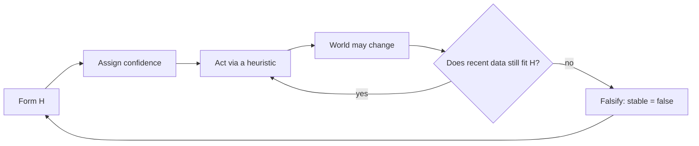
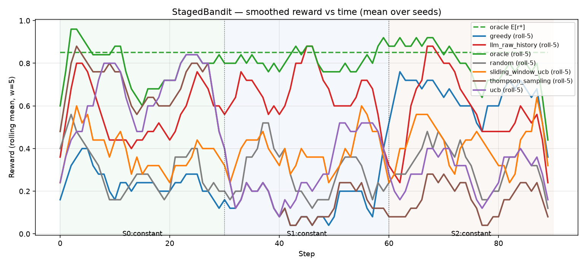
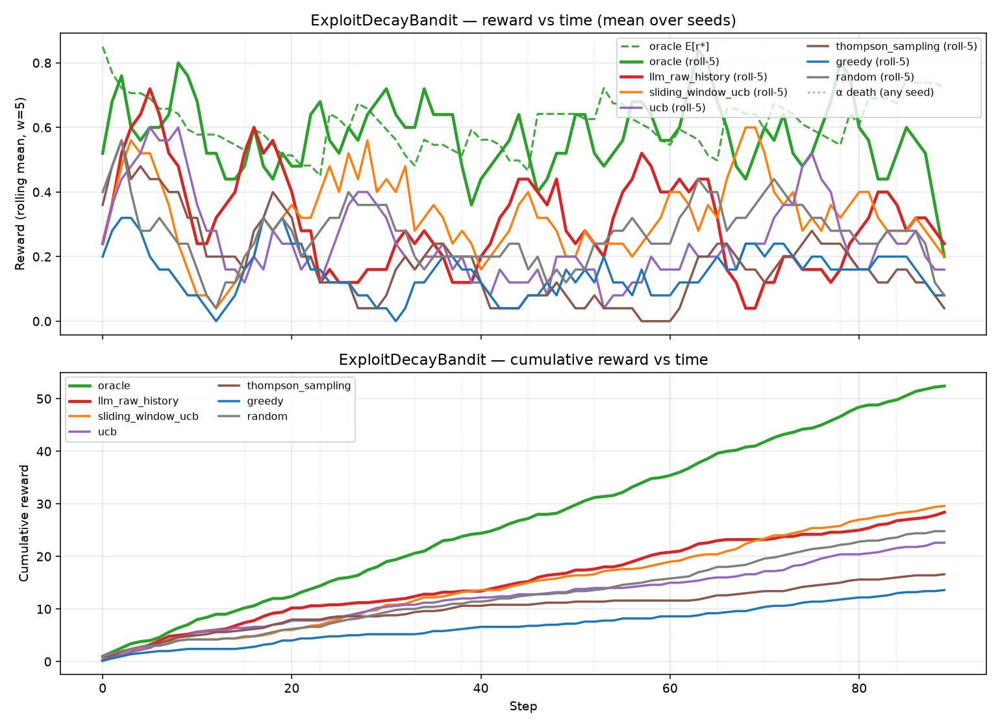
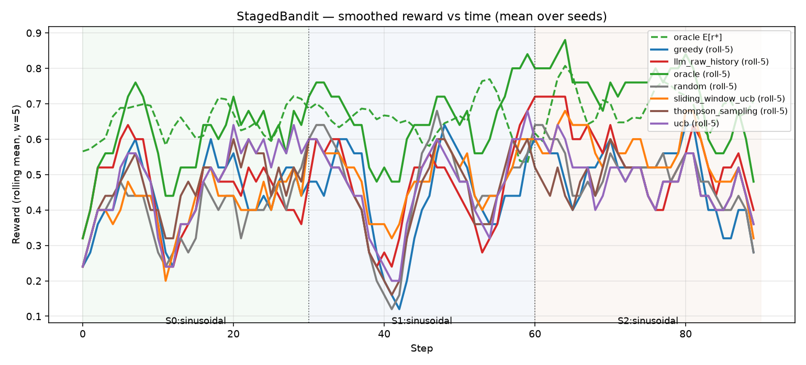
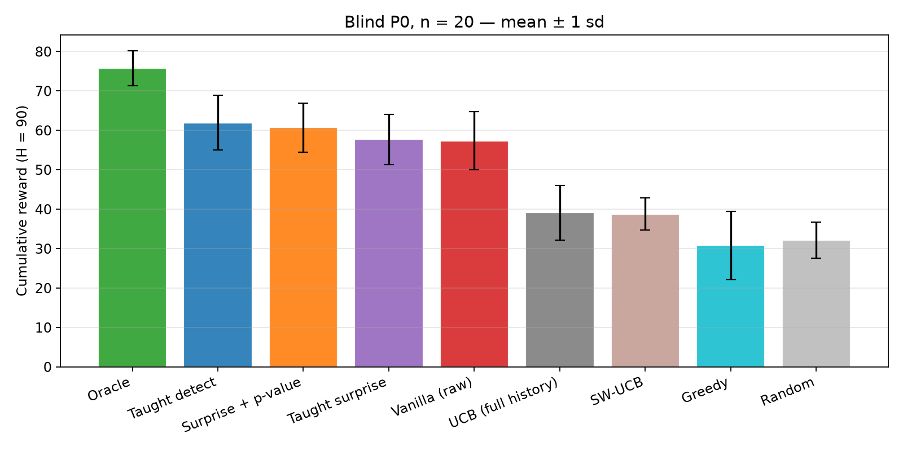
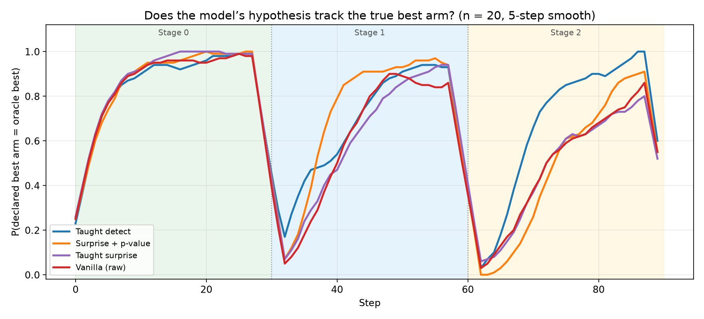
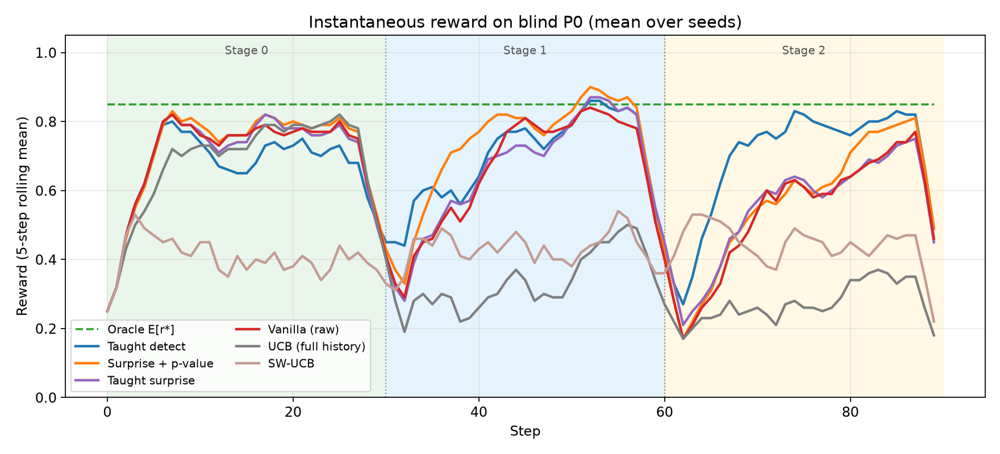
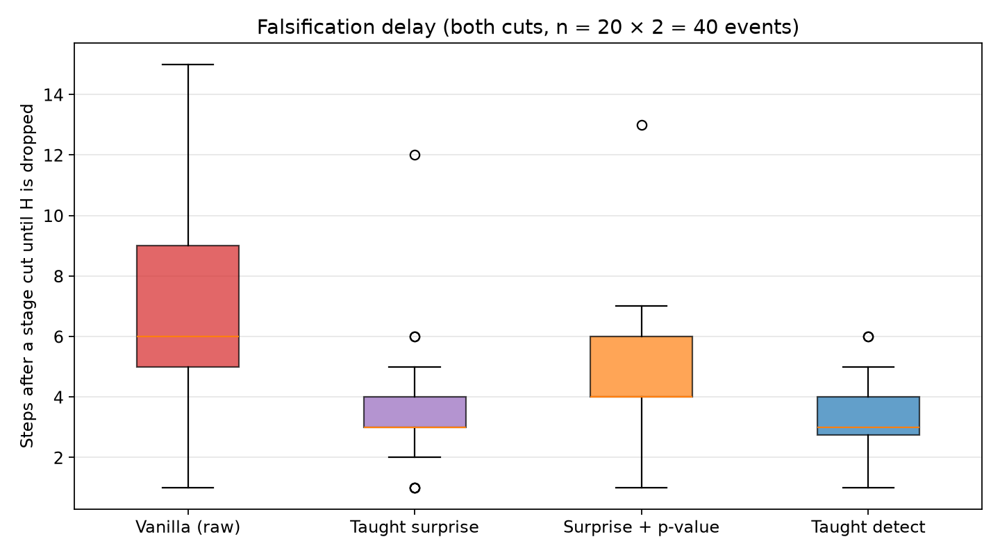
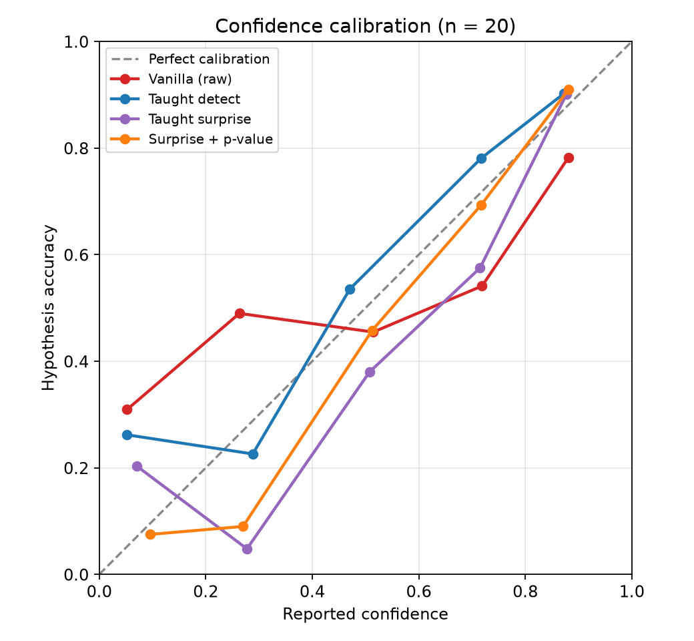

# Group meeting — Can a frozen LLM form, trust, and kill a hypothesis?

**Date:** 24 August 2026  
**Project:** LLM + time (`SpaceHunterInf/llm-time`)  
**Model:** Gemini 3.5 Flash, temperature 0, **weights frozen**  
**This note:** self-contained. No need to have read the code.

---

## TL;DR (if we only have five minutes)

We are not trying to beat UCB at bandits. We are using a tiny non-stationary bandit as a **microscope** for a more general loop:

> Form a hypothesis → assign confidence → act by a heuristic → **falsify** when the world changes → form a new hypothesis.

On a clean “the best arm flips every 30 turns” task (we call it **P0**), with 20 seeds:

1. A frozen Flash **already does the loop**. It locks onto the right arm, and after every flip it eventually drops the old hypothesis. The n=5 smoke test overstated “it never falsifies.”
2. Full-history UCB **does not**. It treats 90 turns as one stationary problem and milks a dead arm. The LLM beats it by a lot (~57–62 vs ~39 reward out of an oracle ~76).
3. Teaching a **P0 cookbook** (“prefer the last-10 mean; if it collapses, drop H”) speeds the kill and is the best score (**61.9**).
4. Teaching a **general belief-revision rule** (“H is a model; if recent pulls are surprising, drop it”) speeds the kill **but does not raise reward**. The model notices surprise — it even says “p ≈ 0.03” — then **puts the old H back on** because lifetime n is large.
5. Handing it an **engine-computed p-value** for that H mostly closes the reward gap (**60.6**) without the cookbook. It does not speed the kill: the model waits until the p-value looks “small” (~0.07), then the revision sticks.

**Punchline:** they can form H. Falsification is teachable as English. Harvesting the new arm is the hard part, and it is not the same skill as noticing that 100 heads is weird.

---

## 1. The research question

A lot of “LLM as agent” work asks: *can it get a high score?* We want a more specific object.

A **frozen** model (no gradient steps, no gold labels, no multi-episode memory) plays a long episode. The only learning channel is **the prompt filling up with its own actions and rewards**. Can it:

1. **Form a hypothesis** about the current world (here: “arm 2 is best”).
2. **Assign confidence** to that hypothesis.
3. **Choose actions** via a heuristic it invents or one we teach.
4. **Falsify** the hypothesis when the world changes.
5. **Re-form** a new hypothesis and lock on again.

If it already does this, we **quantify** delays (lock / falsify / re-lock) and calibration.  
If it does not, we **teach** — in English, or with a number in the observation — and see which part of the loop moves.

Bandits are the first microscope, not the identity of the project. The same JSON loop should later transfer to one other long-horizon task.

This is **in-context hypothesis revision under non-stationarity**, not “build a better UCB.”



---

## 2. How an episode actually works

Think of a Gym loop. Horizon **H = 90** steps. Each step:

1. The environment returns a public observation (step index, last arm, last 0/1 reward). It **never** names the stage, the true probabilities, or “the world just changed.”
2. The agent (LLM or baseline) picks an action `{"arm": k}`.
3. Reward is Bernoulli. Thinking time is **not** simulated — the clock only advances when an arm is pulled.

The LLM is prompted with (depending on condition) a stats table and/or the raw transcript, and must return **one JSON object**. The environment only executes `action`. The other fields are process evidence.

```json
{
  "hypothesis": {"type": "best_arm", "best_arm": 2, "stable": true},
  "confidence": 0.8,
  "heuristic": "exploit_best",
  "heuristic_text": "pull the arm with the best recent mean",
  "action": {"arm": 2},
  "rationale": "..."
}
```

| Setting | Value |
|---|---|
| Model | `gemini-3.5-flash` |
| Temperature | 0 |
| Training | none (frozen) |
| Fair task text | **blind** — no “probabilities may change” |
| Seeds for the main claim | **20** (earlier map was 5) |
| Parallelism | 8 episodes at a time; steps inside an episode stay sequential |

**Baselines** (no hypothesis fields): random, greedy, UCB1 on the *full* history, sliding-window UCB (window 10), and an oracle that always pulls the current best arm.

**Why UCB is the important foil.** UCB1 is optimal for a *stationary* bandit. On P0 it is a stubborn full-history mean: after a flip, the old winner still has a huge `n` and looks best. Sliding-window UCB is the classical “forget” baseline.

---

## 3. The microscope: Staged Bandit P0

A 4-arm Bernoulli bandit whose **best arm jumps** on a calendar, with no announcement.

```text
Steps  0–29   Stage 0   one arm has p ≈ 0.85, others ≈ 0.20
Steps 30–59   Stage 1   a *different* arm is the 0.85 arm
Steps 60–89   Stage 2   a third arm is the 0.85 arm
```

Oracle expected reward is ~0.85 in every stage. The difficulty is not “the ceiling moved.” It is **your theory about which arm is best just died.**

We also ran two harder cousins (still n = 5, action-level only):

| Cell | What changes | Point |
|---|---|---|
| **P0** | 3× constant, distinct best arms | Discrete hypothesis you can check |
| **P1** | sinusoid → constant → linear | Cross-family |
| **P2** | 3× sinusoid | Soft, no stable “best arm” to lock |
| **P0-long** | P0 but H = 180, 6 stages | Is context length the failure mode? |
| **ExploitDecay** | Pulling the current winner *lowers* its p; a new winner spawns | Self-caused death; opposite of greedy |

Fair comparisons use **blind** prompts. An “aware” prompt that says the world may change is an ablation, not the main claim.

---

## 4. Action-level map (n = 5) — before we measured hypotheses

Before the JSON loop, we only scored **pulls**. Blind Gemini vs classical:

| Task | LLM (blind) | UCB | SW-UCB | Oracle | Read |
|---|---:|---:|---:|---:|---|
| P0 (H = 90) | **52.0** | 37.4 | 36.2 | 73.0 | LLM >> stubborn UCB |
| P1 | 40.4 | 37.8 | 33.4 | 58.8 | modest edge (the constant block) |
| P2 | 44.2 | 43.4 | 44.4 | 60.2 | **no edge** on pure sinusoids |
| P0-long (H = 180) | **112** | 67 | 78 | 151 | edge **held** (74% of oracle) |
| ExploitDecay | 28.4 | 22.6 | **29.6** | 52.4 | first hardness cell; LLM **overmines** (~49% vs SW-UCB 16%) |

Telling the model “regimes change” (**aware**) is **not** required for the P0 win. On P0, blind was 52.0 vs aware 50.4. Coaching mainly cuts overcommit; it does not create the skill.

**P0-long** answers “is 90 turns a gift / does the prompt get too long?” Length alone did not break action-level adaptation. Late stages were if anything better than early ones.

**ExploitDecay** is the complementary hardness: the right heuristic is *leave a good arm before it dies*. Vanilla Flash overmines. This is the natural **transfer** test for anything we teach on P0 (a recency-greedy rule should *hurt* here).

Figure 6 is the original P0 action-level picture: the LLM (red) recovers after flips; full-history UCB (purple) and Thompson lock Stage 0 and never come back.



*Figure 6. Blind P0, n = 5, raw-history LLM (no hypothesis schema yet). Rolling reward vs time. Green dashed = oracle expected reward (~0.85). Purple UCB collapses at the first cut and stays down. Red LLM drops, then climbs again.*

Figure 7 is ExploitDecay: greedy/UCB/Thompson finish **below random**. SW-UCB and the LLM are close to each other and far from oracle.



*Figure 7. ExploitDecay, n = 5. Bottom panel is the readable one: cumulative reward. Oracle ~52, SW-UCB ~30, LLM ~28, random ~25, UCB ~23, greedy ~14.*

Figure 8 is P2 (three sinusoids): everybody is in a heap. That is a **soft fail**, not a scoop of “LLMs cannot adapt.”



*Figure 8. P2, n = 5. Soft non-stationarity; LLM ≈ SW-UCB ≈ UCB. We stopped adding sinusoid variants.*

---

## 5. From scoreboard to the loop

Action reward cannot tell **form H** from **lucky habit**. So we forced the schema in §2 and defined:

| Metric | Meaning |
|---|---|
| **Lock time** | Steps until declared `best_arm` matches the oracle best for 3 consecutive steps, per stage |
| **Falsification delay** | After a cut at t = 30 or 60: steps until the hypothesis **leaves** the old best, or `stable = false` |
| **Re-lock time** | After that, steps until it matches the **new** best for 3 steps |
| **Calibration** | Among steps with confidence in a bin, how often H is actually correct |

We also ablated **what the model sees** (no tools):

| Interface | Contents |
|---|---|
| **R** raw | Full action–reward transcript |
| **S** stats | Engine tallies: per-arm n, lifetime mean, last-10 mean |
| **S+R** | Stats table + last 10 raw steps |

Stats are only what a human could count from the same pulls. No hidden `p`, no `best_arm` leak.

n = 5 ablation (for context, not the main claim): raw was the strongest *untaught* condition; stats-only could **entrench** a lifetime-mean H. Teaching detect needed the recency columns.

---

## 6. Main experiment (n = 20): four ways to prompt the same model

Same env (blind P0), same JSON, same model. Only the **English** (and one extra number) change.

### 6.1 Vanilla (raw)

Schema only. Full raw history. No “the world changes,” no recency rule.  
**This is “what does Flash invent?”**

### 6.2 Taught detect — a P0 cookbook

Still blind about *whether* the world changes. But we install a detector:

- Prefer `mean_w` (last 10 pulls of an arm) over lifetime `mean_all` when they disagree.
- If the hypothesized arm’s recent mean **collapses**, set `stable = false`, lower confidence, try another arm.
- Do **not** keep exploiting an arm just because n is large and the lifetime mean is high.
- After dropping H, explore until a new `best_arm` is stable.

This *can* win by being the right sliding-window rule for piecewise-constant P0.

### 6.3 Taught surprise — a meta-rule

Same stats table on screen. **Does not name** `mean_w`, collapse, or regimes:

- Your hypothesis is a model of which arm is best **right now**.
- Confidence should track how well that model predicts the **most recent pulls of that arm**, not how large n is.
- If those pulls are **surprising** under H, set `stable = false` and explore until a new H fits.

This is the “100 heads → maybe the coin is unfair” instruction, without handing over the window statistic.

### 6.4 Surprise + p-value — compute surprise for them

Same surprise English, plus an engine block:

```text
last hypothesis: arm 3
p_hat (lifetime mean of that arm): 0.680  (n=25)
last 5 pulls of that arm: 0,0,0,0,0  (0/5 successes)
P(this many successes or fewer | Bernoulli(p_hat)): 0.0034
```

That probability is **not** the hidden reward rate. It is a one-sided binomial tail under the model’s *own* lifetime mean of the declared arm. The question: if we compute the coin-test for them, do they **keep** `stable = false`, or still restore H because n is large?

---

## 7. Results (n = 20)

### 7.1 Score



*Figure 1. Mean cumulative reward ± 1 sd, H = 90, n = 20. Oracle 75.8. Taught detect 61.9. Surprise + p-value 60.6. Surprise English 57.7. Vanilla raw 57.4. UCB 39.0. SW-UCB 38.7.*

| Agent | Reward | vs oracle | H correct | Stage-0 lock | Falsify delay | Re-lock cut 1 / 2 |
|---|---:|---:|---:|---:|---:|---|
| Oracle | 75.8 ± 4.4 | — | — | — | — | — |
| Taught detect | **61.9 ± 6.9** | 82% | **73%** | 4.7 | **3.2** | 9.9 / **11.1** |
| Surprise + p-value | 60.6 ± 6.2 | 80% | 69% | 4.7 | 4.5 | **8.9** / 14.8 |
| Taught surprise | 57.7 ± 6.4 | 76% | 66% | 4.2 | 3.6 | 12.5 / 12.7 |
| Vanilla (raw) | 57.4 ± 7.4 | 76% | 65% | 4.7 | 6.7 | 11.6 / 15.1 |
| UCB | 39.0 ± 7.0 | 51% | — | — | — | — |
| SW-UCB | 38.7 ± 4.1 | 51% | — | — | — | — |

Paired vs vanilla raw (same seeds):

- Detect **+4.6** (se 1.7; wins 14/20)
- Surprise + p-value **+3.3** (se 1.9; wins 14/20)
- Surprise English **+0.4** (se 2.0; wins 8/20)

Stage-0 **lock is identical** (~4.7 steps). Teaching does not help forming the first H. The whole gap is **after the world changes**.

Vanilla **does** leave the old H on every cut (40/40 events) and usually re-locks. The failure is **slower killing**, not never killing.

### 7.2 Does declared H track the true best arm?



*Figure 2. Fraction of seeds whose declared `best_arm` equals the oracle best, 5-step smooth, n = 20. All four lock in Stage 0, crash at both cuts. Detect (blue) is the only curve that returns to ~1.0 in Stage 2. Surprise + p-value (orange) is fastest after the first cut. Vanilla (red) and surprise-English (purple) recover more slowly, especially late.*

### 7.3 Instantaneous reward (same cuts, including UCB)



*Figure 4. Rolling reward. UCB (gray) is fine in Stage 0 and **dead after the first cut**. All LLM conditions recover. Detect is the Stage 2 standout.*

### 7.4 Falsification delay



*Figure 3. Steps after a cut until H is dropped. 40 events per box. Detect and surprise-English are fast and tight (median ~3–4). Vanilla is slow and spread (median ~6, tail to 15). Surprise + p-value has a vanilla-like median but a much tighter box — they wait for the engine p-value, then move together.*

This is the split to remember:

| | Kill old H | Harvest new arm (reward) |
|---|---|---|
| Vanilla | slow | baseline |
| Surprise English | **fast** | **≈ vanilla** |
| Surprise + p-value | not faster | **≈ detect** |
| Detect | **fast** | **best** |

Falsification and harvesting are **different skills**.

### 7.5 Confidence



*Figure 5. Reliability: reported confidence vs how often H is actually correct. Vanilla is overconfident when very sure. Detect and surprise+p-value sit closer to the diagonal at the high end. Surprise-English stays overconfident until the top bin.*

Vanilla reports ~0.74 confidence at 65% accuracy. Detect: 0.70 at 73%. They are not well calibrated enough for “confidence = exploration schedule” without more work.

---

## 8. What the model actually says (same seed, first cut)

Stage 0’s winner is arm 3. At t = 30 it dies. Three different inner stories.

**Taught detect (t ≈ 29).** It follows the cookbook and stays off the corpse:

> “Arm 3’s recent performance has collapsed with several consecutive 0s… Following the detection rule, set stable false.”

It remains `stable = false` until arm 1 is the new H.

**Taught surprise, no p-value (t = 29).** It *does* the coin test in prose:

> “Arm 3 has a high overall mean of 0.68, but its recent three pulls have all been 0. This is surprising **(p ~ 0.03)** under the hypothesis that it is a 68% reward arm.”

Then at t = 31 and t = 34 it **puts `stable = true` back on**, because the other arms also returned 0 on tiny n. Lifetime mean wins the argument. That is why surprise matches detect on falsify delay and matches vanilla on score.

**Surprise + engine p-value.** Now it *cites the number as a reason to stay*:

> t = 31, engine p = 0.19: “the hypothesis check probability of 0.1926 indicates this is **not highly surprising**, so [keep arm 3].”  
> t = 35, engine p = 0.069: finally `stable = false`, then it locks arm 1 and does not bounce back as hard.

So: handing them surprise does not make them twitchier. It makes the revision **stickier**, and **slower**, because they wait until the printed p-value looks small (~0.07, not three zeros).

Two mechanical reasons the engine tail is conservative (not prompt bugs):

1. The null is the lifetime mean **including** the recent zeros, so as the arm dies, `p_hat` falls and the same zeros look less surprising.
2. The last 5 pulls of that arm still contain old-regime successes for a few steps after the cut.

---

## 9. How to read this against related work

| Paper | What they ask | Why we are not scooped |
|---|---|---|
| Krishnamurthy et al., NeurIPS 2024 | Stationary MAB; raw history often fails exploration unless you add summaries / CoT | We ablate raw vs stats; our object is **non-stationary falsify / re-lock** |
| Monea et al., COLM 2025; Song et al., ICLR 2026 | In-context RL from rewards | Complementary; not hypothesis lifecycle under **change** |
| Classical CUSUM / SW-UCB / discounted UCB | Algorithms that detect+restart | We are measuring whether an **LLM** has that loop, and whether English / a likelihood can install it |
| CEO-Bench (Chen et al., 2026) | 500-day SaaS sim, 34 tools, cash as score | Fat “steering” benchmark. Complementary destination, not this microscope |

CEO-Bench’s world is non-stationary (competitor catch-up, preference drift, macro). They do not report lock / falsify / re-lock against an oracle H. We should **cite them as a Phase 3-shaped world**, not compete as another startup sim.

---

## 10. What we believe, with confidence

**High confidence**

- Frozen Flash, blind, on discrete best-arm flips, **beats full-history UCB** at the action level. P0-long did not kill that.
- With the hypothesis schema, it **forms and locks** H in Stage 0 in ~5 steps, with or without teaching.
- At n = 20 it **does falsify** after every cut. Teaching speeds the kill; it does not create the loop from nothing.
- A recency cookbook (detect) is sufficient to turn fast falsify into extra reward.
- A meta-rule without that cookbook is **not** sufficient for reward. They can notice surprise and still restore H from n.
- Pure sinusoids (P2) and ExploitDecay are different stories. Do not advertise a P0 cookbook as “adaptation.”

**Medium**

- An engine p-value is enough to capture most of detect’s **reward** without naming `mean_w`, via stickier (not faster) revision.
- Confidence is too high relative to accuracy for “use confidence as ε.”

**Open (logged as next)**

1. **Timescale.** Same poles, stage length L = 10 vs 30 (optional L = 5 as a negative control). When the gift lasts 5 turns, we should not expect a pretty re-lock — only a dip in confidence / `stable = false`.
2. **Transfer.** Same schema on **ExploitDecay**. If detect helps there, we taught a trick. If surprise / p-value helps and detect hurts, we taught revision.
3. Park: more P0 English, tools/code, CEO-Bench clone, ε-greedy teach (exploration was not the bottleneck).

---

## 11. Suggested talking points for the meeting

1. We changed the question from “LLM vs UCB” to **hypothesis revision under change**. Bandits are a toy we can oracle.
2. Show Figure 6 (old P0) then Figure 1 (n = 20 bars): the UCB gap is real; teaching is a smaller effect on top.
3. Show Figure 2 and the seed-0 quotes: **they already loop; they revert to n.**
4. Detect vs surprise is the conceptual slide: cookbook vs coin-test. Reward is not the same as falsify delay.
5. Next is L and ExploitDecay, not another prompt that names `mean_w`.

---

## Appendix A — Exact conditions

All main-claim LLM runs: `description_mode: blind`, K = 4, `strong_p = 0.85`, `weak_p = 0.20`, `stage_length = 30`, H = 90, T = 0, `gemini-3.5-flash`.

| Name in logs | Prompt | Interface |
|---|---|---|
| `llm_hyp_raw` | `hypothesis_loop.txt` (schema only) | raw history |
| `llm_hyp_taught_detect` | `hypothesis_taught_detect.txt` | stats + last 10 steps |
| `llm_hyp_taught_surprise` | `hypothesis_taught_surprise.txt` | stats + last 10 steps |
| `llm_hyp_surprise_stat` | `hypothesis_taught_surprise_stat.txt` | stats + last 10 + binomial check |

Runs live in `runs/2026-08-23_benchmark_p0_hypothesis_*` (gitignored). Analyze with:

```powershell
uv run python scripts/analyze_hypothesis_teach.py
```

Roadmap with the same numbers: `09_research_roadmap.md` §11.

---

## Appendix B — Earlier action-level numbers (n = 5, for the map)

**P0 / P1 / P2 prompt ablation (blind / aware / minimal)**

| Task | Aware | Blind | Minimal | UCB | SW-UCB | Oracle |
|---|---:|---:|---:|---:|---:|---:|
| P0 3× constant | 50.4 | 52.0 | 56.4 | 37.4 | 36.2 | 73.0 |
| P1 sin→const→linear | 42.2 | 40.4 | 40.6 | 37.8 | 33.4 | 58.8 |
| P2 3× sin | 45.0 | 44.2 | 42.0 | 43.4 | 44.4 | 60.2 |

**P0-long (H = 180, 6 constant stages, blind):** LLM 112, UCB 67, SW-UCB 78, oracle 151. LLM/oracle = 74% (short P0 blind was 71%).

**ExploitDecay:** LLM 28.4 (overmine 49%), SW-UCB 29.6 (overmine 16%), UCB 22.6, greedy 13.6, random 24.8, oracle 52.4.
