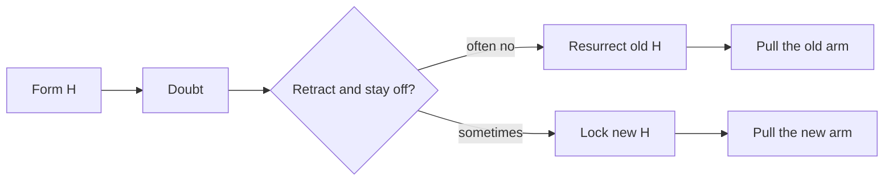
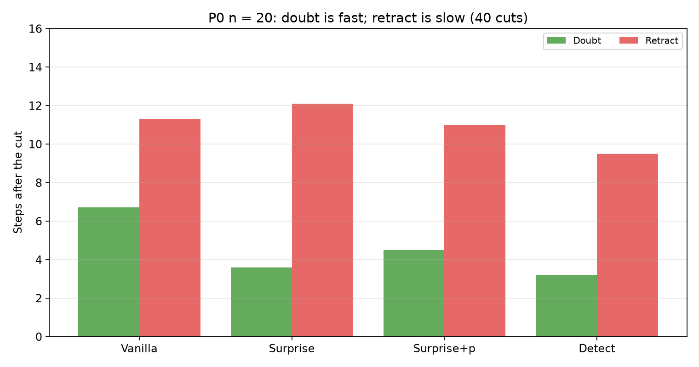
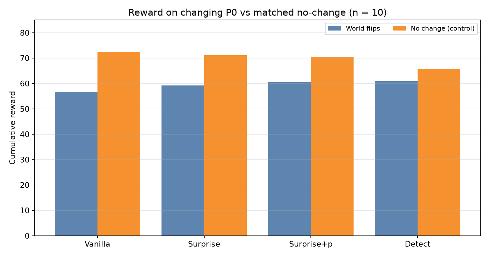
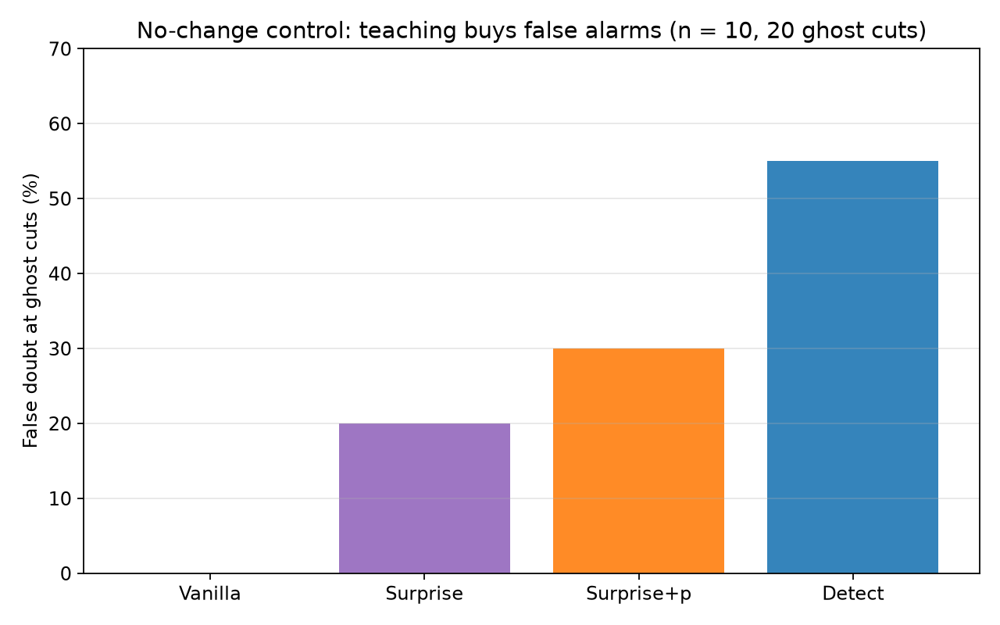
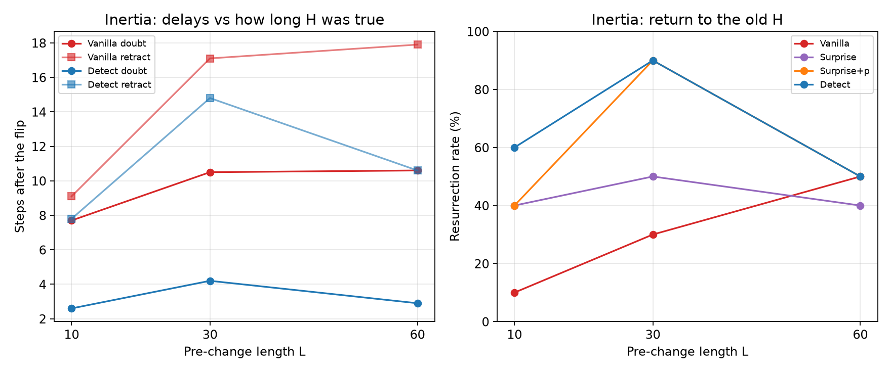
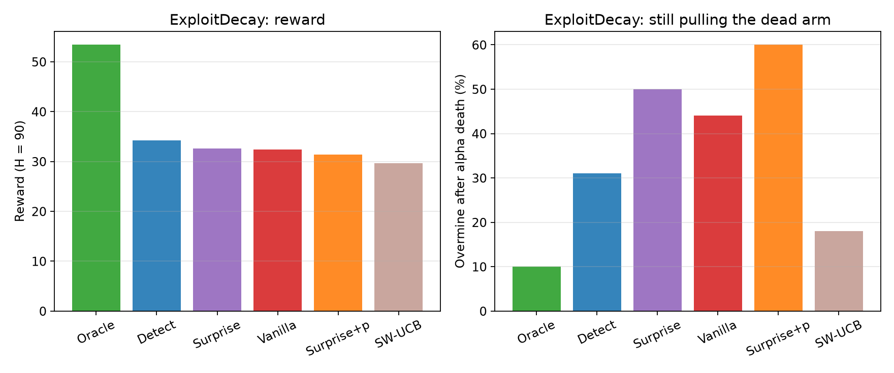

# Week 2 — Doubt, retract, resurrection, and transfer

**Date:** 3 September 2026  
**Follows:** [24 Aug group meeting](group_meeting_2026-08-24.md)  
**Model:** frozen Gemini 3.5 Flash, T = 0, **blind** task text  

---

## TL;DR

A frozen LLM will **form an H** and **get nervous** when the data sour. Unless you install a recency cookbook, it often **talks itself back onto the old H** because n is large — and that is what it then pulls.

Teaching recency helps whenever “recent mean died” is the right local statistic (P0 flips *and* mining an arm to death). It **hurts** when the world did not change. It is not a general revision loop. We do not have a prompt that beats vanilla on both a changing world and a still one.

---

## 1. The question this week

Last week: can they form H, assign confidence, and adapt on a toy non-stationary bandit?

This week:

> How do **belief revision** and **behavioural adaptation** interact when the world stops satisfying the previous hypothesis?

That required splitting “falsify” into **doubt** vs **durable retract**, adding a **no-change control**, measuring **inertia** (how long H was true), and transferring to **ExploitDecay** (you kill the arm by pulling it).

Same JSON every step: `{hypothesis: {best_arm, stable}, confidence, heuristic, action}`.

Four prompts, unchanged:

| Name | Instruction |
|---|---|
| Vanilla | Schema only |
| Surprise | H is a model; drop it if recent pulls are surprising |
| Surprise + p-value | Same + engine binomial tail |
| Detect | Prefer last-10 mean; collapse ⇒ `stable=false`; do not restore from large n |

---

## 2. Doubt is not retract (n = 20 P0 traces, no new API)

**Doubt** = first `stable=false` or declared best ≠ old best.  
**Retract** = first 3 consecutive steps off the old H.  
**Resurrect** = return to the old H after leaving it.

*Figure 1. Mean steps after a cut (40 events). Surprise is fastest to doubt and among the slowest to stay off. Detect is fastest on both, still not fast on retract.*

| | Doubt | Retract | Gap | Resurrect | Pull old while declaring new |
|---|---:|---:|---:|---:|---:|
| Vanilla | 6.7 | 11.3 | 4.5 | **68%** | ~0 |
| Surprise | **3.6** | 12.1 | **8.5** | 45% | 0.02 |
| Surprise + p | 4.5 | 11.0 | 6.5 | 55% | 0.01 |
| Detect | **3.2** | **9.5** | 6.2 | 45% | 0.01 |

Belief–action consistency is high (~0.8). They pull what they declare. Failure is **putting the old H back on**, not secretly milking a corpse. Once they really retract, search onto the new arm is short (~1 step).

---

## 3. Teaching is a change-point prior (random cuts + matched control, n = 10)

Cuts are now random. Control: **same seeds, same ghost times, best arm never flips.** False doubt at a ghost cut is a false revision.

*Figure 2. Blue = world flips. Orange = nothing flips. Every addition helps (a bit) on the left and **hurts** on the right. Detect’s control penalty is larger than its change gain.*

*Figure 3. Vanilla never flinches on noise. Detect false-doubts 55% of ghost cuts. Nobody false-**retracts** a true H. The leak is twitchy exploration.*

If change and no-change are mixed 50/50:

| | Mean of the two worlds |
|---|---:|
| Vanilla | **64.5** |
| Surprise | 65.2 |
| Surprise + p | 65.4 |
| Detect | **63.3** |

Detect **loses the average**. Surprise/p-value do not Pareto-dominate vanilla (they still lose on the control). Vanilla is already near oracle (~76) when nothing changes (72.3). Room to beat it there is tiny.

This is not a worse prior on `p`. It is **P(the world just changed | a few zeros)** set too high.

---

## 4. Vanilla’s inertia is n (one flip after L = 10, 30, 60)

*Figure 4. Left: doubt/retract vs how long H was true. Right: resurrection. Vanilla (red) is the clean curve. Taught prompts still doubt fast; resurrection is noisy at n = 10.*

**Vanilla**

| L | Doubt | Retract | Policy leaves old | Resurrect |
|---|---:|---:|---:|---:|
| 10 | 7.7 | 9.1 | **4.3** | 10% |
| 30 | 10.5 | 17.1 | 8.9 | 30% |
| 60 | 10.6 | 17.9 | 10.0 | **50%** |

At short L the **policy moves before H**. At long L they couple and stick. Retract saturates after L=30; resurrection keeps climbing.

Taught prompts: doubt stays ~3–5 at every L. Resurrection is **not** a monotone L-curve at n=10 (detect 60% / 90% / 50%). Teaching buys fast doubt, not proven immunity to bringing H back.

---

## 5. Transfer: ExploitDecay (you kill the arm)

Pulling the current winner lowers its p; when it dies a new alpha spawns. Same four prompts, n=10, blind.

*Figure 5. Detect is the only LLM that beats vanilla and cuts overmining. Surprise and p-value overmine **more** than vanilla. SW-UCB overmines least and scores worse (leaves too early).*

| | Reward | Overmine | Doubt | Retract | Resurrect |
|---|---:|---:|---:|---:|---:|
| Oracle | 53.4 | 10% | — | — | — |
| Detect | **34.2** | **31%** | **2.7** | **5.8** | 53% |
| Surprise | 32.6 | 50% | 3.6 | 8.4 | 54% |
| Vanilla | 32.4 | 44% | 5.2 | 7.0 | 40% |
| Surprise + p | 31.4 | **60%** | 6.8 | 9.5 | 40% |
| SW-UCB | 29.7 | 18% | — | — | — |

Detect transfers because **recency collapse is the right local cue** both when an arm is swapped and when you mine it to death. That is a cookbook win, not a revision win. Generic surprise still doubts, then milks the dead alpha.

---

## 6. What we can say

1. Blind Flash **can** play a changing bandit without being told it changes, and beats full-history UCB on discrete flips.
2. Declared H **tracks behaviour**. Adaptation fails at **retract-and-stay-off**, not at noticing.
3. Recency teaching is a **change-point prior**. It helps when recent mean dying is the right statistic (P0 *and* ExploitDecay). It **hurts** a still world.
4. Vanilla’s stickiness scales with **how long H was true**.
5. We have **not** found a global prompt that beats vanilla on both a changing world and a still one. Conservative doubt + committed retract is the missing policy; we have not installed it.

## 7. What we should not say

- That they cannot falsify (they can; they don’t commit).
- That detect is general adaptation (it loses the 50/50 mix; it wins when “recent mean died” is the cue).
- That surprise/p-value is the scientific win (right idea; does not bind action on harvest or on ExploitDecay).

**One sentence.** They form an H and get nervous when the data sour; unless you hand them a recency cookbook, n talks them back onto the old H — and that is what they pull.

---

## Appendix — runs and scripts

| Experiment | Configs / analyze |
|---|---|
| n=20 P0 four prompts | `experiment_p0_hypothesis_n20_*.yaml`, `analyze_hypothesis_teach.py` |
| Revision on those traces | `scripts/analyze_revision.py` |
| Random cut + control | `experiment_p0_revision_{change,control}_*.yaml`, `analyze_revision_protocol.py` |
| Inertia L=10/30/60 | `experiment_p0_inertia_L*_*.yaml`, `analyze_inertia.py` |
| ExploitDecay hyp | `experiment_exploit_decay_hyp_*.yaml`, `analyze_exploit_decay_hyp.py` |
| This week’s log | `revision_inertia_2026-09.md` |
